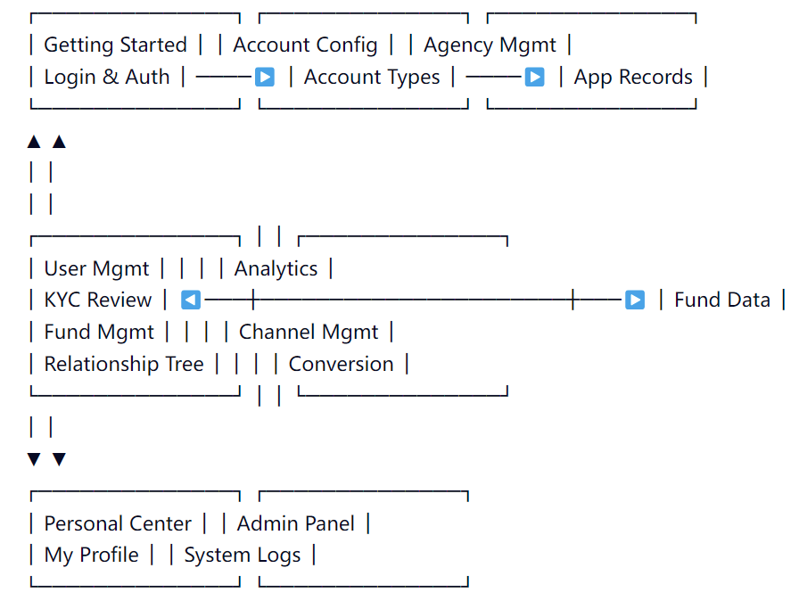

# 图片命名与引用规范（Image Naming & Reference Convention）

> 适用：`crmdocs/`（docsify 站点）。
> 目标：**只凭图片文件名，就能快速精准定位它在文档中的位置**，并保证「正文引用」与「图注编号」始终一致。

---

## 1. 为什么要规范

正文通过编号引用图片（如"见图 02"），而图片文件放在 `images/` 下。若文件名是时间戳（如 `1773641687733.png`），文件与正文之间没有任何共同的「坐标」，彼此无法反查。

规范的核心只有一句话：**让文件名与正文共享同一个编号。**

定位要成立，必须同时满足两件事：

1. 文件名里编码「页面 + 图序」；
2. 正文里出现同一个编号（本规范放在图片的 alt 文本里，可被 grep）。

---

## 2. 目录规则：目录名 = 页面 slug

中英文各有一套 `images/` 目录：

| 语言 | 图片目录 | 正文目录 |
|---|---|---|
| 英文 | `images/<页面slug>/` | `md/<页面slug>.md` |
| 中文 | `zh-cn/images/<页面slug>/` | `zh-cn/<页面slug>.md` |

- `<页面slug>` = 该页 md 文件名去掉 `.md`。
  - `md/trading_server_setup.md` → `images/trading_server_setup/`
  - `zh-cn/快速开始.md` → `zh-cn/images/快速开始/`
- **禁止**使用与页面无关的目录名（历史遗留如 `quick_start_up` 已废弃）。

---

## 3. 文件名规则

```
fig<NN>_<lang>.<ext>
```

| 片段 | 含义 | 取值 |
|---|---|---|
| `fig` | 固定前缀 | `fig` |
| `<NN>` | 图序号，**两位**，从 `01` 开始，**每页重置** | `01`–`99` |
| `_<lang>` | 语言 | `_en`（英） / `_ch`（中） |
| `<ext>` | 扩展名 | `.png` / `.jpg` … |

示例：

```
images/README/fig01_en.png
images/trading_server_setup/fig01_en.png
zh-cn/images/快速开始/fig01_ch.png
```

- 同一张图的中英文版本**共用同一编号**，只有 `_lang` 不同：`fig02_en.png` ↔ `fig02_ch.png`。
- 一页里若有 3 张图，即 `fig01_*`、`fig02_*`、`fig03_*`。
- 编号**按页面独立**，不同页面都从 `fig01` 开始——因为目录（页面）本身已经区分了归属。

---

## 4. 正文引用规则

1. 图片**独立成行**，上下各留一个空行。
2. alt 文本**以图编号开头**，后接该图标题（一般取所在小节标题）。这是编号可被 grep 命中的关键。
3. 正文提到该图时，写同样的编号。

```markdown
## 3. 模块间逻辑关系图



如图 01 所示，各模块之间……
```

---

## 5. 定位工作流（本规范的核心用途）

**已知文件名 → 反查正文位置：**

```
文件名 fig03_en.png
  → 目录 trading_server_setup  = 页面
  → 打开 md/trading_server_setup.md
  → 全文搜索 "Figure 03"（中文文档搜 "图 03"）
  → 直接命中引用处
```

**全库一次搜到：**

```bash
# 按文件名片段定位到页面目录
grep -rn "fig03_en" --include="*.md" .

# 或直接按编号定位正文
grep -rn "Figure 03\|图 03" --include="*.md" .
```

页面目录唯一、编号不跨页重复，所以按 `目录 + 编号` 搜索既精确又不冗余。

---

## 6. 增 / 插 / 删 图片的操作

| 场景 | 操作 |
|---|---|
| **追加**（加到页面末尾） | 用下一个空号，如已有 01、02 → 新图 `fig03_en.png`，正文写 `Figure 03` |
| **插入**（加在 01 与 02 之间） | 新图命名 `fig02_en.png`，**原 02 及之后全部顺延 +1**，并同步改正文编号 |
| **删除** | 删文件 + 删正文引用行；若删中间图，其后编号顺延 −1 |

> 纯序号命名的固有代价：**中间插队必然触发重排**。
> 若某页图片频繁变动、不想重排，可改用「序号+关键词」混合名（如 `03-login_en.png`），代价是正文必须同时写编号才能搜到。当前整套文档统一采用纯序号 `fig<NN>_<lang>`。

---

## 7. 速查：常见错误

| 规则 | 正例 | 反例 |
|---|---|---|
| 目录 = 页面 slug | `images/trading_server_setup/` | `images/quick_start_up/` |
| 序号两位 | `fig01_en.png` | `fig1_en.png` |
| 语言后缀 | `fig02_ch.png` | `fig2中文.png` |
| 图片独立成行 | `` 单独一行 | `说明：` 紧贴正文 |
| 中英同号 | `fig01_en` ↔ `fig01_ch` | `fig1_en` ↔ `fig3_ch` |
| 文件名无中文/空格 | `fig03_en.png` | `登录 页面.png` |

---

## 8. 当前基线（2026-10-14 整理）

| 页面 | 语言 | 文件 | 说明 |
|---|---|---|---|
| README | en | `images/README/fig01_en.png` | 模块逻辑关系图 |
| trading_server_setup | en | `images/trading_server_setup/fig01_en.png` | 下载链接列表界面 |
| zh-cn/README | ch | `zh-cn/images/README/fig01_ch.png` | 模块逻辑关系图（中文） |
| zh-cn/快速开始 | ch | `zh-cn/images/快速开始/fig01_ch.png` | 各模块逻辑关系图 |

### 待处理事项

- **`zh-cn/images/用户/用户注册*.jpg`（4 张）未被任何正文引用**，且目录名 `用户` 不对应任何页面 slug。需确认用途后按规范改名（归入对应页面目录、改用 `fig<NN>_<lang>`）或删除。
